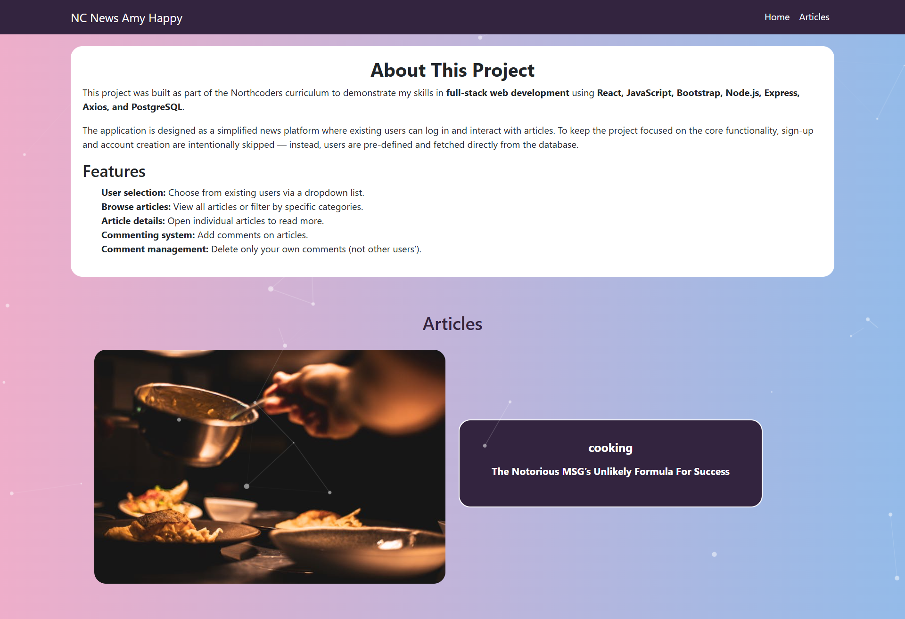
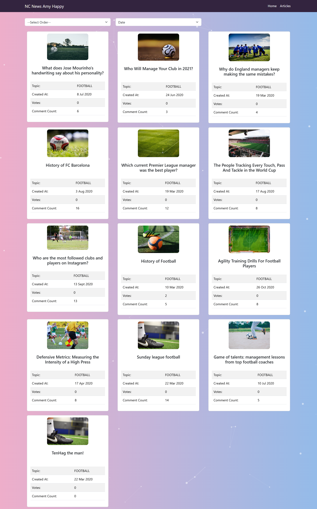
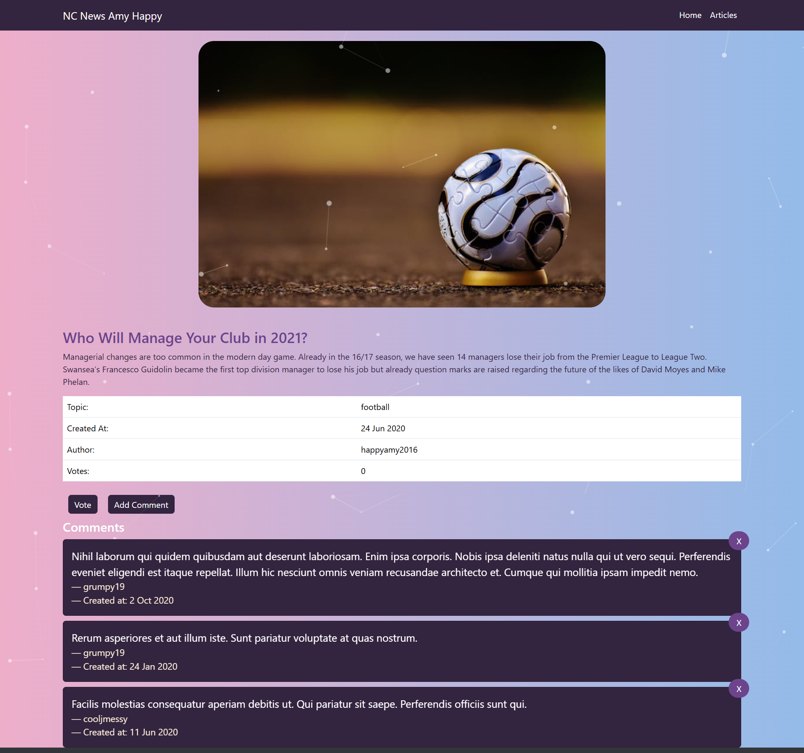

# NC News

NC News is a full-stack news application inspired by Reddit. It allows users to view, filter, and interact with articles across different topics. Users can read articles, vote on them, add comments, and explore community-driven discussions.

---

## Deployment

https://news-artilce.netlify.app/

## Features

- View all articles with pagination
- Filter articles by topic
- Sort articles by votes, comments, or date
- Vote on articles and comments
- Add and delete comments
- Responsive UI built with React and Bootstrap
- Backend powered by Node.js, Express, and PostgreSQL
- Tested using Jest and Supertest

---

## Tech Stack

**Frontend**

- React
- React Router
- Bootstrap / React-Bootstrap
- Axios

**Backend**

- Node.js
- Express
- PostgreSQL
- pg-format

**Testing**

- Jest
- Supertest

---

## Screenshots

### Login Page


### Home Page



### Multiple Articles Page



### Single Article Page



---

## Getting Started

Follow these steps to set up the project locally.

### Prerequisites

- Node.js (>= 18)
- PostgreSQL (>= 14)
- Git

### Installation

1. Clone the repository:
   ```bash
   git clone https://github.com/SuhaimKhalid/Nc-News.git
   cd Nc-News
   ```
2. Install dependencies:
   npm install

3. Set up environment variables:

   Create two files in the root directory:

   .env.development

   .env.test

4. Add the following to each:

   PGDATABASE=your_database_name_here

5. Set up the databases:

   npm run setup-dbs

   Seed the development database:

   npm run seed

6. Start the development server:

   npm run dev

## icense

This project is licensed under the MIT License.
See the LICENSE
file for details.

## Author

Suhaim Khalid

GitHub: SuhaimKhalid

Email: suhaimkhalid007@gmail.com
